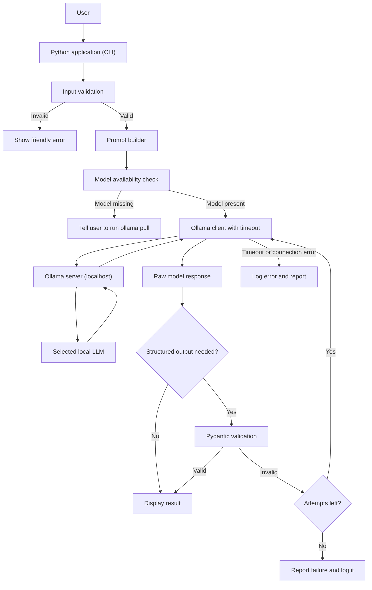
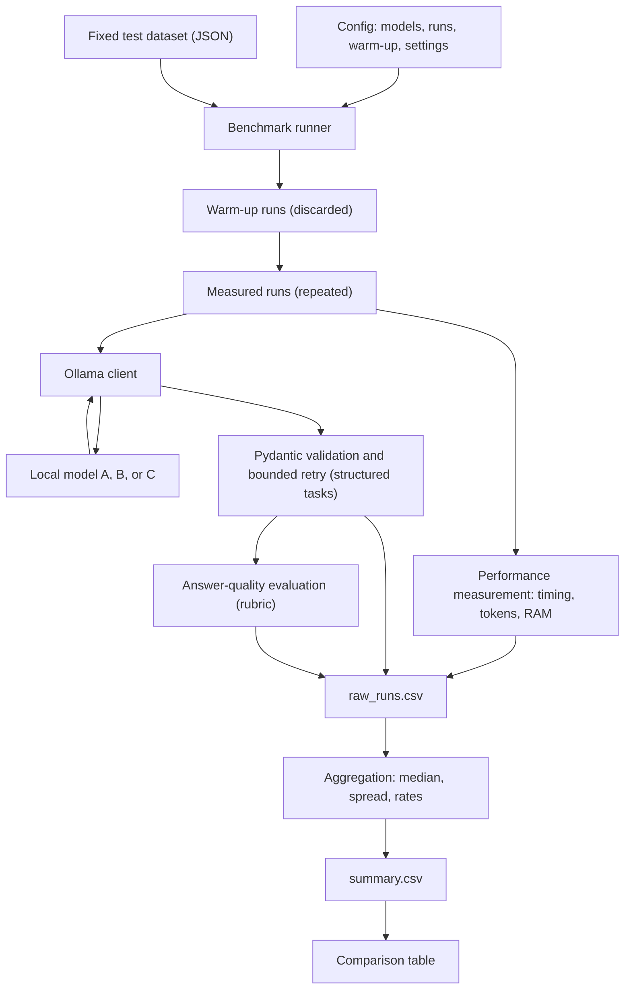
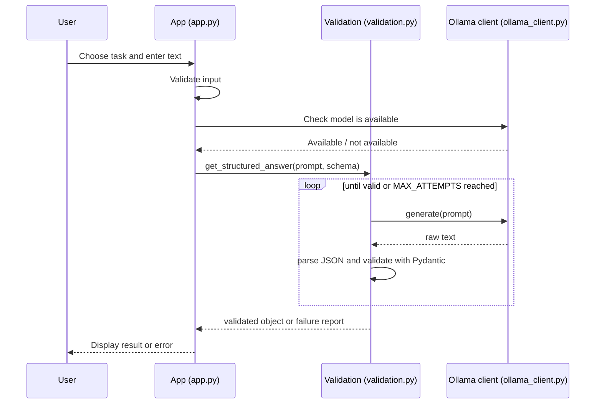
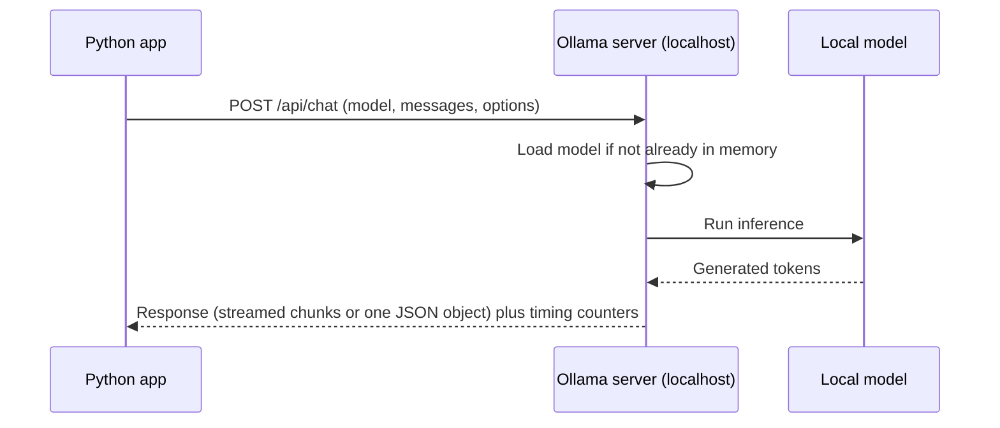
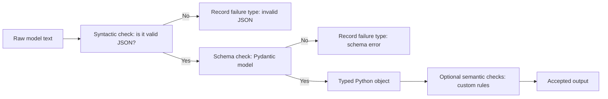
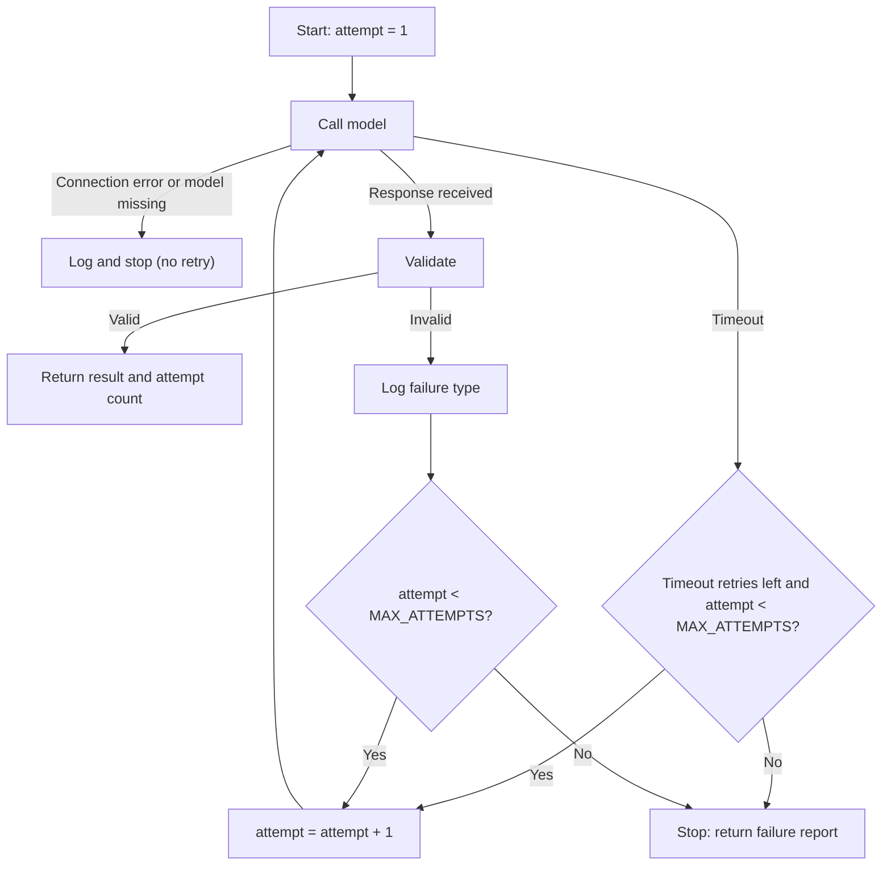
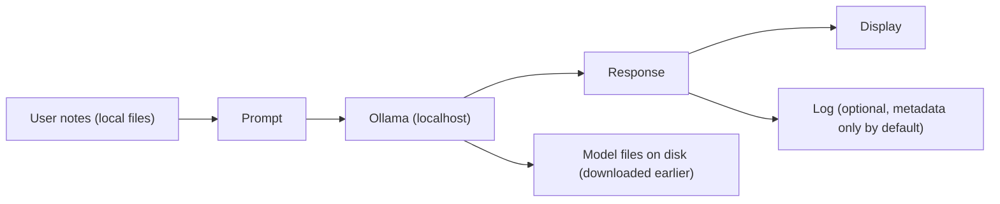

# Architecture

[Back to README](./README.md)

> **Status:** design only. No component below has been implemented or tested. Labels (**[PLANNED]**, **[VERIFY]**, **[ILLUSTRATIVE]**) are explained in the [README](./README.md#read-this-first-status-legend).

---

## 1. Review of the Starting Architecture

The starting architecture was:

```text
User -> Python Application -> Ollama API (local) -> Selected local LLM -> Generated response
     -> Pydantic validation (if structured) -> Retry if validation fails -> Display result
```

It is a good core. The following improvements make it safer and more measurable:

| # | Improvement | Why |
|---|---|---|
| 1 | Add **input validation** before calling the model | Reject empty, huge, or malformed input early. |
| 2 | Add a **model availability check** (is the model downloaded?) | Gives a clear error instead of a confusing failure. |
| 3 | Add **timeouts** around every Ollama call | A stuck request must not hang the program. |
| 4 | Make the retry loop **bounded** (maximum attempts) | Prevents infinite loops and runaway cost/time. |
| 5 | Separate **three failure types**: connection/timeout error, invalid JSON, schema mismatch | Each needs different handling and different statistics. |
| 6 | Add **logging** | Needed to measure reliability and debug failures. |
| 7 | Add a separate **answer-quality evaluation** step in the benchmark | Validation is **not** quality (see [PYDANTIC_AND_VALIDATION.md](./PYDANTIC_AND_VALIDATION.md)). |
| 8 | Add **warm-up runs** and **repeated runs** with a **configuration** file | Fair, repeatable benchmarking. |
| 9 | Store **raw** results and **summary** results separately | Raw data allows re-analysis. |

## 2. Architecture Diagram: Runtime (Assistant)



## 3. Architecture Diagram: Benchmark Pipeline



## 4. User Interaction Flow **[PLANNED]**

1. The user starts the program and picks a model (or uses the default in the config file).
2. The user chooses a task: *ask a question*, *explain a topic*, *summarize notes*, or *generate exam questions*.
3. The program validates the input (not empty, within a size limit, file readable).
4. The program builds a prompt from a template plus the user's text or notes.
5. The program checks that Ollama is running and the model exists.
6. The program sends the prompt and waits (with a timeout).
7. The result is shown. For exam questions, it is validated first.
8. If something fails, the user sees a short, clear message, not a stack trace.

## 5. Python Application Flow **[PLANNED]**



## 6. Ollama Communication Flow

The Python program talks to Ollama over HTTP on the **same computer**. Typical endpoints **[VERIFY in the official API reference]**:

| Endpoint | Purpose |
|---|---|
| `GET /api/tags` | List downloaded models (availability check) |
| `POST /api/chat` | Chat-style request with messages |
| `POST /api/generate` | Single prompt completion |
| `GET /api/ps` | Show models loaded in memory |
| `POST /api/show` | Show model details |

Request options we plan to control: model tag, temperature, random seed, maximum output tokens, context length, streaming on/off, and an optional output `format` (JSON or a JSON schema) **[VERIFY supported options for your Ollama version]**.

Response fields useful for benchmarking (non-streaming final response; durations are in nanoseconds) **[VERIFY]**: `total_duration`, `load_duration`, `prompt_eval_count`, `prompt_eval_duration`, `eval_count`, `eval_duration`.



## 7. Local Model Inference

Inference happens inside the Ollama process on your hardware:

1. **Model loading:** weights are read from disk into RAM (or GPU memory). This can take seconds and is why the *first* request is slower.
2. **Prompt processing:** the input text is converted to tokens and processed.
3. **Token generation:** the model produces the answer one token at a time.
4. **Unloading:** after an idle period, Ollama may unload the model to free memory **[VERIFY keep-alive behavior]**.

No part of this needs an external AI service. (Downloading a model with `ollama pull` does need internet access.)

## 8. Benchmarking Pipeline (Stage by Stage) **[PLANNED]**

| Stage | What happens | Output |
|---|---|---|
| Configuration | Load model tags, number of runs, settings | Config object |
| Dataset loading | Read fixed prompts with IDs and categories | List of test cases |
| Pre-flight check | Confirm each model is downloaded; record hardware and versions | Environment record |
| Warm-up | Run one or more throwaway requests per model | Model loaded; results discarded |
| Measured runs | Run every prompt N times per model | Raw measurements |
| Measurement | Record timing, token counts, RAM | Numbers per run |
| Validation | For structured tasks, validate and retry (bounded) | Valid/invalid, attempts |
| Quality evaluation | Score answers with a rubric | Scores |
| Storage | Append rows to `raw_runs.csv` | Raw CSV |
| Aggregation | Compute median, spread, rates | `summary.csv` |
| Reporting | Render comparison table | Markdown table |

Fairness rules are in [MODEL_BENCHMARK.md](./MODEL_BENCHMARK.md).

## 9. Pydantic Validation Pipeline



Pydantic cannot check whether the content is *true*. See [PYDANTIC_AND_VALIDATION.md](./PYDANTIC_AND_VALIDATION.md).

## 10. Retry Mechanism



Rules:

- `MAX_ATTEMPTS` is a fixed number in the config (for example 3; to be decided).
- The loop is a `for` over a fixed range, **not** an open-ended `while True`.
- Every attempt is logged with its failure type.
- **Retry policy by failure type:**

| Failure type | Retry? | Reason |
|---|---|---|
| Invalid JSON or schema error | Yes, up to `MAX_ATTEMPTS` | The model's output may differ next time. |
| Timeout | At most once (`MAX_TIMEOUT_RETRIES = 1`, in the config). A timeout retry also counts toward `MAX_ATTEMPTS`. | The model may have been slow once, but repeated timeouts mean a real problem. |
| Connection refused, model not found | No | Retrying cannot fix a stopped server or a missing model. Report a clear error. |

- Because timeout retries use the same attempt budget, the total number of model calls for one task never exceeds `MAX_ATTEMPTS`.
- In the benchmark, record the *first-attempt* result **and** the final result, otherwise retries hide unreliable models.

## 11. Results Storage

| File | Content | Notes |
|---|---|---|
| `results/raw_runs.csv` | One row per run | Never overwritten; append only |
| `results/summary.csv` | One row per model (and per category) | Regenerated from raw data |
| `logs/app.log` | Events and errors | May contain sensitive text, so default to logging IDs and lengths, not full prompts |
| `data/benchmark_prompts.json` | Fixed dataset | Version-controlled; contains no private notes |

## 12. Data Flow



The intended rule: **notes and prompts flow only inside the computer.** This is a design goal that must be tested, not assumed (see [PRIVACY_AND_SECURITY.md](./PRIVACY_AND_SECURITY.md)).

## 13. Component Responsibilities

| Component (planned file) | Responsibility | Why it exists |
|---|---|---|
| User | Provides questions and notes | The source of tasks |
| Application (`app.py`) | Menu, task selection, display | Keeps user interaction in one place |
| Configuration (`config.py`) | Model tags, timeouts, max attempts, paths | Avoids hard-coded values; makes runs reproducible |
| Input validation | Rejects bad input | Prevents errors and misuse |
| Ollama client (`ollama_client.py`) | All communication with Ollama; timeouts; model check | One place to change if the API changes |
| Ollama server | Loads models, runs inference, serves API | Does the heavy work |
| Local LLM | Generates text | The "brain" |
| Schemas (`schemas.py`) | Pydantic models describing expected output | Defines "valid" |
| Validation and retry (`validation.py`) | Parse, validate, retry within limit, log | Reliability |
| Metrics (`metrics.py`) | Timing, token rates, memory | Measurement |
| Benchmark runner (`benchmark.py`) | Orchestrates warm-up, runs, storage | Repeatable experiments |
| Evaluator (`evaluation.py`) | Applies the quality rubric | Quality is separate from validity |
| CSV writer | Stores raw and summary results | Simple, portable, reviewable |
| Tests (`tests/`) | Check behavior automatically | Confidence while changing code |

## 14. Terminology Used Consistently

- **Python application**: our program.
- **Ollama server**: the local API and runtime.
- **Local LLM** or **model**: the open-weight model loaded by Ollama.
- **Model A / B / C**: the three compared models (TBD).
- **Run**: one request to one model for one prompt.
- **Warm-up run**: a discarded run before measuring.
- **Attempt**: one try inside the retry loop; a run may need several attempts.
