# Implementation Roadmap

[Back to README](./README.md)

> **Status:** plan only. **All phases are [PLANNED]; none is started.** Update the checkboxes as you really complete each phase. Labels are explained in the [README](./README.md#read-this-first-status-legend).

This roadmap assumes you know **no** AI/ML and only a little Python. Go in order. Do not move on until the completion checklist is ticked. Use [GLOSSARY.md](./GLOSSARY.md) whenever a word is new.

```mermaid
flowchart LR
    P1["1 Python"] --> P2["2 Ollama"] --> P3["3 First model"] --> P4["4 Chatbot"] --> P5["5 Three models"]
    P5 --> P6["6 Measurement"] --> P7["7 Dataset"] --> P8["8 Pydantic"] --> P9["9 Retries"]
    P9 --> P10["10 Quality"] --> P11["11 CSV and tables"] --> P12["12 Notes assistant"] --> P13["13 Testing"] --> P14["14 Final docs and demo"]
```

---

## Phase 1: Python Prerequisites

- **Objective:** Be comfortable writing and running small Python programs.
- **Concepts to learn:** variables, strings, lists, dictionaries, functions, loops, `if`, exceptions (`try/except`), reading and writing files, modules and `import`, virtual environments, `pip`, type hints (basic).
- **Tasks to complete:**
  1. Install Python; check `python --version` (or `python3 --version`).
  2. Create a project folder and a virtual environment; activate it.
  3. Write small scripts: read a text file, count words, save a list to a JSON file, write a CSV file using the `csv` module.
  4. Write a function with a `try/except` block.
- **Expected output:** A few working practice scripts; you can explain each line.
- **Completion checklist:**
  - [ ] Python runs in a virtual environment
  - [ ] I can read and write text, JSON, and CSV files
  - [ ] I can handle an exception
  - [ ] I installed a package with `pip`
- **Common mistakes:** installing packages globally instead of in the virtual environment; forgetting to activate it; mixing tabs and spaces; naming a script the same as a library (for example `json.py`).
- **Questions to ask my mentor:** Which Python version should we standardize on? Is a virtual environment enough, or should we pin exact package versions in `requirements.txt`?

## Phase 2: Install and Understand Ollama

- **Objective:** Install Ollama and understand what it does.
- **Concepts to learn:** LLM, local inference, Ollama vs a model, local server, port, API, model tag, quantization (idea only).
- **Tasks to complete:**
  1. Install Ollama from the official site.
  2. Run `ollama --version`.
  3. Run `ollama list` (probably empty at first).
  4. Check the server: `curl http://localhost:11434/api/tags` (use `curl.exe` in PowerShell) **[VERIFY]**.
  5. Write 5 sentences explaining Ollama in your own words.
- **Expected output:** Ollama installed; the local server responds; your own written explanation.
- **Completion checklist:**
  - [ ] `ollama --version` works
  - [ ] I know how to start/check the server
  - [ ] I can explain "Ollama is not a model"
  - [ ] I recorded my Ollama version
- **Common mistakes:** thinking Ollama is the AI; the server not running; port blocked by another program; not enough disk space for models.
- **Questions to ask my mentor:** Is it acceptable to use a laptop for benchmarking? How should we handle the model download size?

## Phase 3: Run the First Local Model

- **Objective:** Download one small model and chat with it in the terminal.
- **Concepts to learn:** model tags, parameters ("3B", "7B"), model size on disk, license, context window, `ollama pull/run/ps/show`, hallucination.
- **Tasks to complete:**
  1. Fill in your hardware table (see [MODEL_BENCHMARK.md](./MODEL_BENCHMARK.md#3-hardware-record-fill-in-before-testing)).
  2. Pick **one small** model that fits your RAM; read its license; `ollama pull <tag>`.
  3. `ollama run <tag>`; ask 5 questions; type `/bye` to exit.
  4. Run `ollama ps` while it is loaded; note what you see.
  5. Ask something the model should not know; observe a wrong answer.
- **Expected output:** A working local chat; notes on speed, memory, and one hallucination example.
- **Completion checklist:**
  - [ ] Model downloaded and tag recorded
  - [ ] I read its license
  - [ ] I saw `ollama ps` output
  - [ ] I can explain hallucination with an example
- **Common mistakes:** downloading a model too large for RAM; using `latest` without writing down what it was; trusting every answer.
- **Questions to ask my mentor:** How should we choose the three models? Are there licensing rules we must follow for a college project?

## Phase 4: Build a Basic Python Chatbot

- **Objective:** Talk to the model from Python instead of the terminal.
- **Concepts to learn:** HTTP API (idea), the `ollama` Python library, messages (role and content), streaming vs non-streaming, timeouts, exceptions.
- **Tasks to complete:**
  1. `pip install ollama`.
  2. Write a script that sends one prompt and prints the answer.
  3. Turn it into a loop that keeps the conversation history in a list.
  4. Add input checks (not empty; size limit).
  5. Add error handling for "server not running" and "model not found"; add a timeout.
- **Expected output:** A simple command-line chatbot with friendly error messages.
- **Completion checklist:**
  - [ ] Script gets an answer from the local model
  - [ ] Conversation history works
  - [ ] Stopping Ollama gives a clean error message, not a crash
  - [ ] Model name is not hard-coded in many places
- **Common mistakes:** forgetting to keep message history; no timeout; catching all exceptions silently; sending the wrong model tag.
- **Questions to ask my mentor:** Should we use the Python library or call the HTTP API directly (fewer dependencies vs convenience)?

## Phase 5: Test Three Local Models

- **Objective:** Choose three models and confirm each runs on your computer.
- **Concepts to learn:** model families, parameter count, quantization trade-offs, license differences, open-source software vs open-weight models.
- **Tasks to complete:**
  1. Apply the selection process in [MODEL_BENCHMARK.md](./MODEL_BENCHMARK.md#4-how-to-select-three-models).
  2. Pull the three models; record exact tags, sizes, licenses.
  3. Ask each model the same five questions; save the answers to a text file.
  4. Make the chatbot accept `--model <tag>`.
- **Expected output:** Three models installed; a model-selection table filled in; a first informal impression of each.
- **Completion checklist:**
  - [ ] Three tags and licenses documented
  - [ ] Each model runs from Python
  - [ ] Reasons for choosing each are written down
- **Common mistakes:** choosing three nearly identical models without noticing; ignoring license terms; running out of disk space; judging by one answer.
- **Questions to ask my mentor:** Is comparing different families, or one family at three sizes, a better research question for us?

## Phase 6: Implement Performance Measurement

- **Objective:** Measure speed and memory correctly.
- **Concepts to learn:** latency, time to first token, total time, tokens per second, nanoseconds vs seconds, `time.perf_counter()`, streaming, RAM vs model file size, `psutil`, process memory, cold vs warm start.
- **Tasks to complete:**
  1. Time a full request with `time.perf_counter()`.
  2. Use streaming to capture time to first token.
  3. Read token counts and durations from Ollama's response; compute tokens per second **[VERIFY field names]**.
  4. Use `psutil` and `ollama ps` to observe memory of the Ollama process.
  5. Run the same prompt 5 times; observe variation; compare cold vs warm.
- **Expected output:** A small `metrics.py` that returns a dictionary of measurements for one request; you can explain each number.
- **Completion checklist:**
  - [ ] TTFT and total time measured separately
  - [ ] Tokens per second computed from reported counts
  - [ ] Memory measured on the Ollama process, not the Python script
  - [ ] Units are labeled (seconds, MB)
- **Common mistakes:** mixing nanoseconds and seconds; measuring Python's memory instead of Ollama's; counting load time in tokens per second; measuring only once.
- **Questions to ask my mentor:** How accurate must memory measurements be? Should we report cold-start time separately?

## Phase 7: Create a Fixed Benchmark Dataset

- **Objective:** Create the exact prompts that every model will receive.
- **Concepts to learn:** dataset, test case, categories, reference answers, reproducibility, data leakage (do not put private notes into a public repo).
- **Tasks to complete:**
  1. Write 20 to 40 test cases (final number TBD) in `data/benchmark_prompts.json`, each with `id`, `category`, `prompt`, and `key_points`.
  2. Cover: Q&A from provided notes, explanation, summarization, exam-question generation.
  3. Use short, non-private sample text (for example public-domain or self-written material).
  4. Freeze the file (commit it); do not change it mid-benchmark.
- **Expected output:** A version-controlled JSON dataset and a short description of each category.
- **Completion checklist:**
  - [ ] Every test case has an ID and key points
  - [ ] Dataset contains no confidential data
  - [ ] Dataset is frozen before measuring
- **Common mistakes:** changing prompts between models; using prompts that only suit one model; no reference key points (making quality scoring impossible).
- **Questions to ask my mentor:** Is the dataset size enough? Is there a good source of non-private notes for testing?

## Phase 8: Implement Pydantic Validation

- **Objective:** Check structured output automatically.
- **Concepts to learn:** JSON, schema, Pydantic, `BaseModel`, `Field`, `ValidationError`, syntactic vs schema vs semantic vs factual correctness. Read [PYDANTIC_AND_VALIDATION.md](./PYDANTIC_AND_VALIDATION.md).
- **Tasks to complete:**
  1. Define `ExamQuestion` and `ExamQuestionSet`.
  2. Validate hand-written good and bad JSON strings.
  3. Classify errors (`invalid_json` vs `schema_error`).
  4. Call a model with a JSON-format request and validate its output.
- **Expected output:** `schemas.py` and a function that returns a typed object or a clear failure type.
- **Completion checklist:**
  - [ ] Valid and invalid examples behave as expected
  - [ ] I can explain why valid does not mean correct
  - [ ] Failure types are recorded
- **Common mistakes:** thinking validation checks facts; schema too strict or too loose; not handling extra text around JSON; ignoring token-limit truncation.
- **Questions to ask my mentor:** Which outputs need strict schemas? Should semantic rules be part of validation?

## Phase 9: Implement Bounded Retry Logic

- **Objective:** Recover from invalid output without risking endless loops.
- **Concepts to learn:** retry, bounded retry, maximum attempts, failure types, logging, idempotency (safe to repeat), timeouts.
- **Tasks to complete:**
  1. Write `get_structured_answer` with a `for` loop over a fixed number of attempts.
  2. Return the number of attempts used.
  3. Log each failure with metadata (not full text).
  4. Write a test with a fake model function that always fails; prove it stops.
  5. Record first-attempt and final success separately.
- **Expected output:** Reliable retry function and logs showing attempt counts.
- **Completion checklist:**
  - [ ] Maximum attempts in config
  - [ ] No `while True` retry loops
  - [ ] Timeouts on every call
  - [ ] Test proves the loop terminates
- **Common mistakes:** unbounded loops; retrying errors that cannot succeed; hiding first-attempt failures; logging confidential text.
- **Questions to ask my mentor:** What retry limit is reasonable? Should error messages be fed back to the model?

## Phase 10: Evaluate Answer Quality

- **Objective:** Score answers with a clear, repeatable method.
- **Concepts to learn:** evaluation, rubric, subjective vs objective measures, blind evaluation, inter-rater agreement, bias, hallucination.
- **Tasks to complete:**
  1. Finalize the rubric (see [MODEL_BENCHMARK.md](./MODEL_BENCHMARK.md#7-answer-quality)).
  2. Create a scoring sheet (CSV) with model names hidden.
  3. Score a sample; re-score some later or ask a classmate; compare.
  4. Fix unclear rubric items.
- **Expected output:** A tested rubric and a scoring procedure.
- **Completion checklist:**
  - [ ] Rubric written before scoring
  - [ ] Scoring is blind
  - [ ] I checked consistency on a sample
- **Common mistakes:** scoring after seeing model names; vague criteria; favoring longer answers; changing the rubric after seeing results.
- **Questions to ask my mentor:** Is single-person scoring acceptable? Is automatic scoring worth including?

## Phase 11: Generate CSV Results and Comparison Tables

- **Objective:** Run the full benchmark and produce results.
- **Concepts to learn:** raw vs summary data, median, spread, warm-up, repeated trials, CSV format, reproducibility.
- **Tasks to complete:**
  1. Write the benchmark runner: warm-up, then N measured runs per prompt per model.
  2. Save every run to `results/raw_runs.csv`.
  3. Aggregate into `results/summary.csv`.
  4. Generate the Markdown comparison table from real data.
  5. Interpret results using the fair-comparison rules.
- **Expected output:** Real raw and summary CSVs and a filled-in comparison table. Until this phase is done, all table cells remain `TBD`.
- **Completion checklist:**
  - [ ] Warm-up rows excluded from summary
  - [ ] Raw data preserved
  - [ ] Hardware and versions recorded
  - [ ] Failures included, not hidden
- **Common mistakes:** overwriting raw results; averaging away failures; benchmarking with other heavy programs running; claiming a winner from tiny differences.
- **Questions to ask my mentor:** How many repetitions are enough? How should we present uncertainty?

## Phase 12: Build the Semester-Notes Assistant

- **Objective:** Turn what you learned into a useful tool.
- **Concepts to learn:** prompt templates, context window limits, chunking long notes (idea), reading local files safely, user-friendly CLI design.
- **Tasks to complete:**
  1. Implement four tasks: answer a question, explain a topic, summarize notes, generate exam questions (validated).
  2. Load notes from a local folder; limit input size.
  3. Choose the default model based on benchmark results and your use-case priorities.
  4. Show clear errors; keep logs free of note contents by default.
- **Expected output:** A working command-line assistant.
- **Completion checklist:**
  - [ ] All four tasks work
  - [ ] Exam questions pass validation
  - [ ] Long notes handled with a clear limit or warning
  - [ ] Default model choice justified by data
- **Common mistakes:** exceeding the context window silently; trusting summaries without checking; committing private notes to Git.
- **Questions to ask my mentor:** How should we handle notes longer than the model's context window? Is retrieval over notes in scope or a future improvement?

## Phase 13: Testing and Debugging

- **Objective:** Make the program trustworthy.
- **Concepts to learn:** unit tests, mocks (fake model), edge cases, logging, reproducing bugs. Read [TESTING_AND_EVALUATION.md](./TESTING_AND_EVALUATION.md).
- **Tasks to complete:**
  1. Write `pytest` tests for input validation, schema validation, retry limits, and error handling.
  2. Run the privacy checks in [PRIVACY_AND_SECURITY.md](./PRIVACY_AND_SECURITY.md).
  3. Execute the designed tests and record real results (pass/fail, date, environment).
  4. Fix bugs; re-run.
- **Expected output:** A test report separating *designed* tests from *executed* tests.
- **Completion checklist:**
  - [ ] Tests pass or failures are documented
  - [ ] Timeouts and missing-model cases tested
  - [ ] Network check performed
  - [ ] Execution log filled in honestly
- **Common mistakes:** counting a designed test as executed; only testing the happy path; tests that need a real model for every run (use fakes too).
- **Questions to ask my mentor:** Which tests are most important to show in the demo?

## Phase 14: Final Documentation and Demonstration

- **Objective:** Present the project honestly and clearly.
- **Concepts to learn:** reproducible research, honest reporting of limitations, presenting trade-offs.
- **Tasks to complete:**
  1. Update every document: replace **[PLANNED]** with **[IMPLEMENTED]** only for things you actually built *and* ran; fill the tables with real data.
  2. Re-read the FAQ and practice answers aloud ([FAQ_AND_MENTOR_PREPARATION.md](./FAQ_AND_MENTOR_PREPARATION.md)).
  3. Prepare a 5 to 10 minute demo (offline, to show it works without internet).
  4. State limitations and future work.
- **Expected output:** Updated documentation, demo script, final presentation.
- **Completion checklist:**
  - [ ] No claims without evidence
  - [ ] Labels updated truthfully
  - [ ] Demo rehearsed
  - [ ] Repository clean (no private data)
- **Common mistakes:** leaving old "TBD" values; overstating privacy; skipping limitations; a demo that depends on the internet.
- **Questions to ask my mentor:** What would make the project stronger? What should be the next step after submission?
