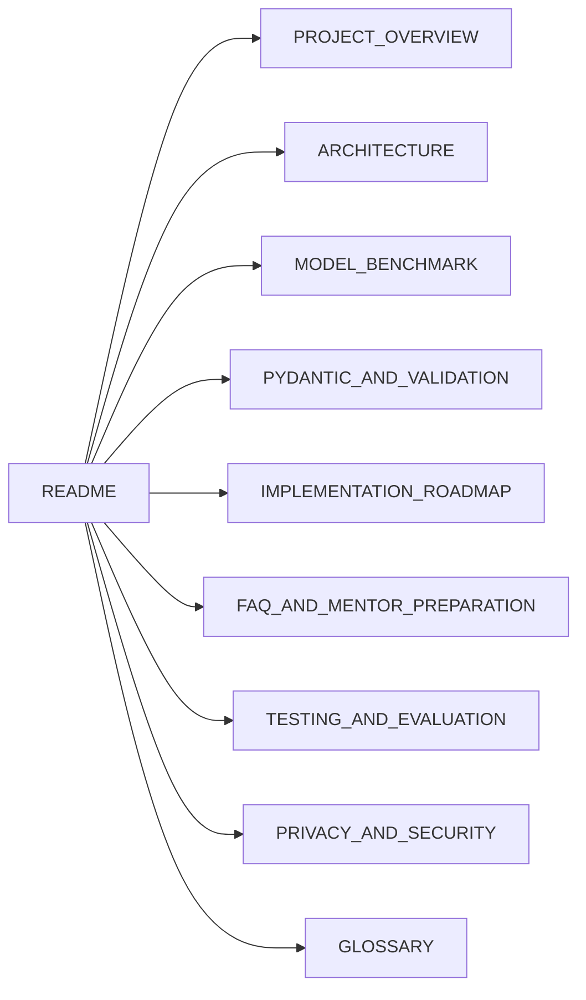

# Project Overview

[Back to README](./README.md)

> **Status:** documentation and planning only. Nothing described here has been built or tested yet. Labels such as **[PLANNED]** and **[VERIFY]** are explained in the [README](./README.md#read-this-first-status-legend).

This document explains the project from scratch. You do not need prior AI knowledge.

---

## 1. What Is This Project?

The project is called **Offline AI Assistant + Model Benchmark**. It has two parts:

1. **An assistant [PLANNED].** A Python program that lets you ask questions about your semester notes, get topic explanations, summaries, and practice exam questions. The "brain" is an AI language model running **on your own computer**, not on a company's server.
2. **A benchmark [PLANNED].** A fair experiment that compares **three** different language models on speed, memory use, answer quality, and reliability, so we can choose with evidence.

## 2. What Problem Does It Solve?

- **Privacy problem:** online AI tools receive whatever you type. For confidential text (client documents, business plans), that can be unacceptable.
- **Choice problem:** many models exist. Without measurement, you cannot know which one fits your computer and your task.
- **Reliability problem:** programs need answers in a predictable format (for example, a list of questions in JSON). Models sometimes break the format. We need to detect and handle that.

## 3. Why Local AI Matters

| Benefit | Explanation |
|---|---|
| Less data leaving your device | Prompts can be processed on your own machine instead of being sent to an AI provider. |
| Control | You choose the model, version, and settings. |
| Works without internet (after setup) | Models are downloaded once, then can run offline **[VERIFY on your setup]**. |
| Predictable cost | No per-request fees (you pay with your own hardware and electricity). |

**Important caution:** local does **not** automatically mean "completely private" or "completely secure." Logs, files, other software, and misconfiguration can still leak data. See [PRIVACY_AND_SECURITY.md](./PRIVACY_AND_SECURITY.md).

## 4. What Is an LLM?

A **Large Language Model (LLM)** is a computer program trained on huge amounts of text to predict what text should come next. By repeating that prediction word-piece by word-piece, it can answer questions, summarize, and write.

Example: given "The capital of France is", an LLM predicts " Paris" because that pattern was common in its training data.

Key facts for beginners:

- An LLM is mostly a very large file of numbers called **weights** (also called parameters).
- It does not "look things up" by default. It generates likely text, so it can be **wrong while sounding confident** (called *hallucination*).
- Models are measured in parameters (for example "3B" means about 3 billion).

## 5. What Does "Local Inference" Mean?

- **Training** = teaching a model by showing it lots of data (very expensive; we are **not** doing this).
- **Inference** = *using* a trained model to produce an answer.
- **Local inference** = running inference on your own computer (using its CPU, and a GPU if available) instead of a remote server.

## 6. What Does Ollama Do?

**Ollama** is a free tool that makes running models locally much easier. It:

- downloads models (`ollama pull`),
- stores them on your disk,
- loads them into memory when needed,
- runs inference,
- offers a **local web API** (by default at `http://localhost:11434` **[VERIFY]**) that your Python program can call.

Without Ollama, you would have to set up model files, inference software, and hardware settings yourself.

## 7. Ollama vs an LLM

| | Ollama | An LLM |
|---|---|---|
| What is it? | Software (a runtime/manager and server) | A trained model (a large file of weights) |
| Analogy | A music player | A song file |
| Can it answer questions alone? | No, it needs a model | Not by itself; it needs software to run it |
| Examples | Ollama | Llama, Qwen, Gemma, Mistral, Phi families (check the library for current names) |

**Ollama is not an AI model.** It runs AI models.

## 8. Why Compare Multiple Models?

- Models trade off **size, speed, quality, and memory**. A bigger model is often more capable but slower and hungrier for RAM.
- Different models follow formatting instructions with different reliability.
- A comparison gives evidence for your final choice and teaches you how to evaluate AI scientifically.
- **Three** models is a manageable number for a first project: enough to see trade-offs, few enough to test thoroughly.

The models are not chosen yet. Selection rules are in [MODEL_BENCHMARK.md](./MODEL_BENCHMARK.md).

## 9. Real-World Use Cases

| Use case | Why local helps |
|---|---|
| **Student notes assistant** (this project's first use case) | Free, private, works offline. |
| **Law firm** drafting/summarizing | Client documents are confidential. |
| **Business** internal document Q&A | Trade secrets, HR data. |
| **Healthcare or finance prototypes** | Strict data-handling rules (always consult compliance experts). |
| **Field work with poor internet** | No connection needed after setup. |

This project is a learning prototype, **not** a certified solution for any regulated industry.

## 10. Project Scope

**In scope [PLANNED]:**

- Local chat and notes assistant using Ollama and Python
- Three-model benchmark with documented method
- Pydantic validation with bounded retries
- CSV results and comparison tables
- Honest documentation of limits

**Out of scope:**

- Training or fine-tuning models
- Cloud deployment or multi-user servers
- Web frameworks, databases, or vector search (possible future work)
- Legal, medical, or compliance guarantees
- Claims of absolute security

## 11. Expected Deliverables

| Deliverable | Status |
|---|---|
| 10 Markdown documents (this package) | Created (documentation only) |
| Working Python assistant | [PLANNED] |
| Benchmark runner and fixed dataset | [PLANNED] |
| `raw_runs.csv` and `summary.csv` | [PLANNED] |
| Filled comparison table with real measurements | [PLANNED] |
| Test results (executed, not just designed) | [PLANNED] |
| Final demonstration and mentor presentation | [PLANNED] |

## 12. How the Documents Fit Together

Suggested reading order for a beginner: Overview, Glossary, Roadmap, Architecture, Benchmark, Pydantic, Testing, Privacy, FAQ.
